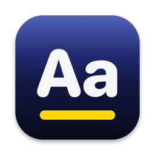

# Presenter Notes



A small Mac app that shows your speaker notes in very large print and keeps them in step with a Google Slides slideshow.

I am visually impaired and could not read the speaker notes that slideshow tools put under the slide. This app puts the notes on their own screen, in text as large as you need, and changes the note when the slide changes.

## What it does

- Shows one note per slide in a normal Mac window, in large, bold, high-contrast text on black. Move it, resize it, make it full screen with the green button, or switch away with Cmd+Tab.
- Follows Google Slides. When the slide changes, the note for that slide appears. This works in the editor, in a slideshow, and when you jump to any slide. It keeps following while another app is in front.
- Lets you select, copy and find text in the note, and scroll a long note with the mouse or trackpad. The text always wraps to the width of the window.
- Moves the slideshow with the notes. Ctrl+Opt+Right and Ctrl+Opt+Left turn the note and press Right or Left in the browser, so the slide moves too. This works in any browser, including Zen and Firefox. Turn it off with Move the slideshow with the notes in the menu bar.
- Turns the notes with Ctrl+Opt+Right and Ctrl+Opt+Left from any app, or with the Right and Left arrow keys when the window is in front. Ctrl+Opt+Up and Ctrl+Opt+Down change the text size.
- Keeps several sets of notes, one per slideshow, with a large-print editor that saves as you type.

## Requirements

- macOS 14 or later.
- Xcode command line tools, to build it.
- Google Chrome for slide following. See [Limits](#limits) for other browsers.
- Two screens work best: slides on one, notes on the other.

## Build and run

```sh
./build.sh
open "build/Presenter Notes.app"
```

The build script signs the app with an Apple Development identity if your keychain has one. macOS then remembers the app's permissions between builds. Without one it signs ad hoc, and macOS asks for the permissions again after each build.

The first time it runs, the app creates `~/PresenterNotes/notes.txt` with a short sample.

## The notes window

Opening the app shows the notes window. It is an ordinary window. It does not float over other apps.

- The note for the slide on screen fills the window. You can select it, copy it, and search it with Cmd+F. You cannot type in it.
- **Previous** and **Next** turn the notes. So do Ctrl+Opt+Left and Ctrl+Opt+Right from any app, and the Left and Right arrow keys when the window is in front.
- The bar at the bottom shows the name of the set and which note is showing, or "No note for this slide".
- A bar at the top shows messages, such as a permission macOS still needs. Press **OK** to close it.
- To make it full screen, use the green button or press Ctrl+Cmd+F.

Close the window and the app stays in the menu bar. To get the window back, press Ctrl+Opt+N, choose Show notes window from the menu bar, or open the app again.

## Editing notes

Everything happens in the one window. Press **Edit notes**, Ctrl+Opt+E or Cmd+E to show an edit box on the left. The notes stay on the right, so you see each change as you type. Press **Hide editor** or the same keys to hide it again.

- The edit box holds the note showing on the right, as plain text at one size. Headings and bold only show on the right.
- Turn to another slide and the edit box moves to that slide's note.
- Changes save as you type, and again when you hide the editor, switch sets or quit. Only the note's text changes. The `slide:` lines stay as they were.
- On a slide with no note yet, just start typing. The app creates a note for that slide.
- Cmd+Plus and Cmd+Minus change the size of the edit box text while you are typing in it.

Sets of notes are in the **File** menu: **New Set of Notes**, **Open Set**, **Delete This Set** (it asks first, and the set goes to the Trash) and **Open the Notes Folder**. The Notes menu in the menu bar also lists every set.

## Permissions macOS will ask for

| Permission | Needed for | When it is asked |
|---|---|---|
| Automation, for your browser | Following the slides | The first time the app asks the browser which slide is showing |
| Accessibility | Moving the slideshow when you turn a note | The first time you turn a note |
| Screen Recording | The optional "check notes are hidden" test | The first time you press Ctrl+Opt+T |

Notes cannot follow the slides until you allow the Automation prompt. If the prompt goes unanswered, the notes window says so in the bar at the top.

## Writing notes

Notes are plain text files in `~/PresenterNotes`. A line of three dashes starts the next note.

```
deck: https://docs.google.com/presentation/d/YOUR-DECK-ID/edit

slide: g2f1b_0_5 (1. Title)
Welcome everyone
Thank the team
---
slide: g2f1b_0_9 (2. Results)
Revenue is up
Mention the launch
```

- `deck:` is optional. With it, the app opens this file by itself when that deck is showing in your browser.
- `slide:` ties a note to a slide. Use the slide's ID or paste a link to the slide. Text after the ID is a label for you and is ignored.
- Without `slide:` lines, notes are shown in order and you turn them yourself.

### Headings, bold and bullets

Notes use a little Markdown to make some text stand out. Sizes are a share of your text size, so changing the text size scales everything together.

| You type | The notes window shows |
|---|---|
| `# Heading` | Twice the size of normal text |
| `## Heading` | 175% |
| `### Heading` | 150% |
| `#### Heading` | 130% |
| `##### Heading` | 115%, still bigger than normal text |
| `**words**` | Heavier bold |
| `*words*` | Italic |
| `- item` | A bullet point |

The notes window hides the symbols. The edit box shows them as plain text at one size. Files stay plain text.

To find a slide's ID, select the slide in Google Slides and look at the end of the address: `#slide=id.g2f1b_0_5`.

A note can be longer than the window. Scroll it with the mouse wheel, the trackpad or Ctrl+Opt+Page Down.

## Writing notes with Claude

The [skill/presenter-notes](skill/presenter-notes) folder holds a skill for Claude Code. Give Claude a Google Slides link and ask for presenter notes. It reads the deck's speaker notes, writes a notes file with one note per slide and the `slide:` lines filled in, and checks the file against the deck. It writes short keyword notes by default, or the speaker notes word for word if you ask for "full".

To install it, copy the folder into your Claude skills folder:

```sh
cp -R skill/presenter-notes ~/.claude/skills/
```

It needs the Google Slides connector in Claude. The helper script, `notes_tool.py`, uses only the Python standard library and can also be run by hand. Run it with `--help` to see how.

## Shortcuts

These work from any app while the notes window is open. Ctrl+Opt+N and Ctrl+Opt+Shift+Q work at any time.

| Shortcut | What it does |
|---|---|
| Ctrl+Opt+N | Show the notes window |
| Ctrl+Opt+Right / Left | Next or previous slide and note |
| Ctrl+Opt+0 | Back to the first slide and note |
| Ctrl+Opt+Page Down / Page Up | Scroll a long note. On a laptop keyboard: Fn+Ctrl+Opt+Down / Up |
| Ctrl+Opt+Up / Down | Bigger or smaller text |
| Ctrl+Opt+C | Change text colour |
| Ctrl+Opt+E | Show or hide the editor |
| Ctrl+Opt+O | Open another notes file |
| Ctrl+Opt+F | Follow slides on or off |
| Ctrl+Opt+I | Show status |
| Ctrl+Opt+T | Check notes are hidden from screen sharing |
| Ctrl+Opt+H | Show or hide the shortcuts |
| Ctrl+Opt+Shift+Q | Quit |

When the notes window is in front, the Right and Left arrow keys also turn the notes, and the Up and Down arrow keys scroll one line of text at its current size. A mouse wheel notch also moves one line, so bigger text scrolls further. The usual Mac keys work too: Cmd+C to copy, Cmd+F to find, Cmd+W to close, Ctrl+Cmd+F for full screen.

## Menu bar

The app adds a **Notes** item to the menu bar. Its menu uses larger text than a normal menu and offers:

- Show the notes window, and edit notes.
- Next and previous note.
- Bigger text, smaller text, or a text size picked from a list.
- Slide following on or off. A tick shows when it is on.
- Every notes file in `~/PresenterNotes`, with a tick on the one in use. Choose one to switch slideshows.
- Choose another file, or open the notes folder.
- Show shortcuts, show status, and quit.

A notes file with a `deck:` line opens by itself when that deck comes up in the browser. A file you pick by hand stays in use until a different deck comes up.

## How moving the slideshow works

When you turn a note, the app presses Right or Left in the browser that was last in front. If the notes window is in front, the browser comes forward for a moment to take the key, then the notes window comes back. In Chrome, if the slide does not change (for example the key played an animation), the note goes back to the slide on screen after a second and a half.

## How following works

Google Slides keeps the ID of the current slide in the page address. A few times a second, while one of the app's windows is open, the app asks the browser for the address of its Google Slides tab and shows the note whose `slide:` line matches. It reads the address only. It does not read the page.

When another app is in front, including Presenter Notes itself, the app asks the browser that last showed Google Slides. A note you turn by hand stays until the slide changes.

## Limits

- **Browsers.** Tested with Google Chrome. Brave, Microsoft Edge and Safari are wired up the same way and are untested. Firefox and browsers built on it, such as Zen, do not let other apps read the address, so following cannot work there.
- **Google Slides only.** Keynote and PowerPoint are not supported.
- **Screen sharing.** The app marks its window as excluded from screen sharing. On macOS 15 and later, some meeting apps ignore that mark when you share an entire screen. Keep the notes on a screen you are not sharing, or share a single window.
- **Mirrored displays.** A mirrored projector shows the notes to the room. Use extended displays.
- **Changed decks.** If you add or duplicate slides, add `slide:` lines for the new slides. A slide with no note shows "No note for this slide".

## Troubleshooting

Press Ctrl+Opt+I to show the status in the notes window. It shows which notes are in use and which slide the app can see.

The app writes a short log to `~/Library/Logs/PresenterNotes.log`. It holds slide and deck IDs and what the app did. It never holds the text of your notes or full web addresses.

## Self-test

```sh
"build/Presenter Notes.app/Contents/MacOS/PresenterNotes" --snapshot /tmp/presenter-notes-test
```

This runs the built-in checks, prints the results, writes pictures of the notes window to the folder, and quits. The shortcuts and key presses in the self-test are simulated inside the app, so no real keys are sent. Use an empty folder each time.

## Icon

The icon is drawn by a script, so it can be changed without a drawing app. `tools/make_icon.sh` redraws it and rebuilds `Resources/AppIcon.icns`. Pass `lines` for the alternative design.

## Code

The whole app is one Swift file, [Sources/main.swift](Sources/main.swift), using AppKit with no dependencies.

## Licence

MIT. See [LICENSE](LICENSE).
